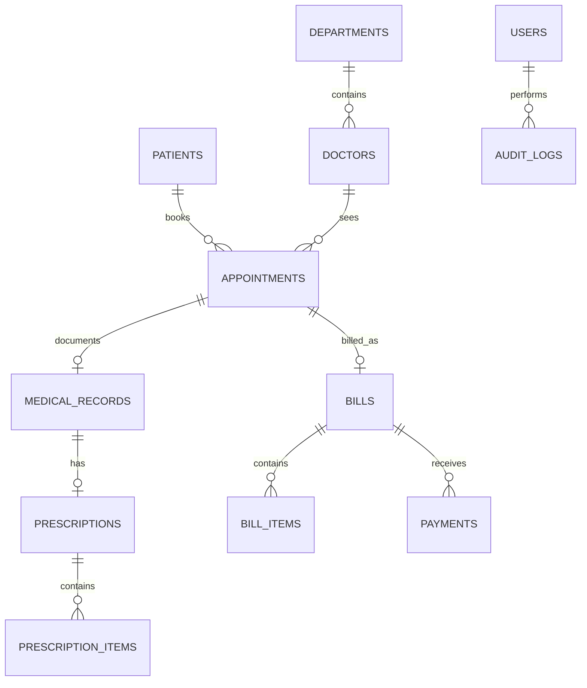

# Hospital Management Portal

A beginner-oriented desktop application built with Java Swing, Core Java, JDBC, MySQL, Maven, and BCrypt. Application data is stored in MySQL; the program does not ship hardcoded patient or user accounts. This is an educational example and is not certified for clinical or production deployment.

## Features

- Login, logout, BCrypt password hashes, active accounts, administrator-created users, and role checks in service classes.
- Patient registration, search with paging, viewing, updating, and deactivation while preserving history.
- Department and doctor directory, consultation fees, availability windows, and active status.
- Appointment scheduling against doctor working hours, with a transaction and doctor-row lock to serialize overlap checks; cancellation, completion, and no-show status.
- Medical records for completed visits and multi-item prescriptions.
- Invoices with decimal totals/discounts and multiple partial payments. Invoice locks keep balances consistent and overpayments are rejected.
- Audit events for important actions; SQL uses `PreparedStatement` and JDBC resources use try-with-resources.
- Graphical login and role-aware tabs for patients, doctors, departments, appointments, clinical records, prescriptions, billing, reports, and user management.
- MySQL schema with foreign keys, constraints, and search indexes.

## Requirements

- JDK 21
- Maven 3.9+
- MySQL 8.0+

The project has not been compiled in this environment because neither Java nor Maven is installed or available on PATH.

## Database setup (Windows PowerShell)

Run from the project directory. Adjust the MySQL executable path and account for your installation:

```powershell
Get-Content src/main/resources/db/schema.sql | mysql -u root -p
Get-Content src/main/resources/db/seed.sql | mysql -u root -p hospital_db
```

Schema timestamps use UTC (`TIMESTAMP` and server session `time_zone = '+00:00'`). Appointment date/time values use the hospital's local wall clock (`DATETIME`); keep the MySQL server and application host configured for the same agreed hospital timezone. For a multi-time-zone deployment, store appointment instants in UTC and retain an explicit hospital zone.

Set credentials for the current PowerShell session (do not commit them):

```powershell
$env:DB_URL = 'jdbc:mysql://localhost:3306/hospital_db?serverTimezone=UTC'
$env:DB_USER = 'hospital_app'
$env:DB_PASSWORD = 'use-a-local-secret-here'
```

Use a dedicated MySQL application account with only the permissions needed by the app; do not run the app as MySQL root. For example, create the database with an administrative account, then grant the runtime user access to `hospital_db`.

### First administrator

The app does not create a default or hardcoded administrator. For the first launch only, when the `users` table has no rows, provide bootstrap credentials:

```powershell
$env:BOOTSTRAP_ADMIN_USER = 'hospital-admin'
$env:BOOTSTRAP_ADMIN_PASSWORD = 'choose-a-unique-password-at-least-12-chars'
```

Start the app once. It stores only a BCrypt hash. Remove both variables after the administrator is created:

```powershell
Remove-Item Env:BOOTSTRAP_ADMIN_USER
Remove-Item Env:BOOTSTRAP_ADMIN_PASSWORD
```

Register additional accounts from **User management** as an administrator. A DOCTOR user must be associated with the existing doctor ID.

## Build, test, and run

```powershell
mvn clean test
mvn package
mvn exec:java
```

The JUnit tests cover validation and invoice arithmetic without needing MySQL. To manually exercise database operations, install the schema, configure the environment variables, bootstrap an administrator, then use the menus to create a department, doctor, availability, patient, and appointment. Appointment dates must be future dates and fall within a configured availability period. Mark a visit completed before adding its medical record or invoice.

## Project structure

```text
src/main/java/com/hospital/
  Main.java                 application entry point and secure initial admin setup
  model/                    domain records and enums
  dao/                      JDBC SQL and row mapping
  service/                  validation, authorization, and transaction workflows
  util/                     database configuration and shared validation/access rules
  ui/                       Swing desktop window and legacy console menus
src/main/resources/db/
  schema.sql                MySQL schema
  seed.sql                  optional fictional development departments
src/test/java/com/hospital/ JUnit unit tests
```

### Relationship overview



## Access roles

- `ADMIN`: user, department, doctor administration and broad reports.
- `RECEPTIONIST`: patient and appointment workflows; directory access.
- `DOCTOR`: permitted patient search, assigned appointment workflow, clinical records and prescriptions.
- `BILLING_STAFF`: invoices, payments, and billing views.

Service methods enforce access even if a caller bypasses the interface. Passwords are entered in masked Swing fields. `Main.java` launches the desktop window; the earlier console menu remains available in `MainMenu` for reference.

## Current limitations

- Doctor availability is configured as recurring weekday time windows without holidays or exceptions. Appointment duration is entered by the receptionist; it is not forced to match each configured slot size.
- Doctor and department editing, CSV export, payment reversal workflow, medical record correction history, and user listing are not exposed through the console.
- The unit tests are not database integration tests. Appointment locking semantics and MySQL constraints need manual verification against a local MySQL instance.
- For production, add stronger audit attribution and change history, clinic-specific timezone handling, secure secret storage, backups, operational monitoring, and privacy/security review.

## Learning notes

SQL stays in DAO classes; services enforce permissions and coordinate domain rules; the UI only gathers line-based input. Monetary values use `BigDecimal`/`DECIMAL`. Multi-step database changes disable auto-commit, commit only after all writes succeed, and roll back on failure. A database constraint is a second line of defense alongside Java validation.
