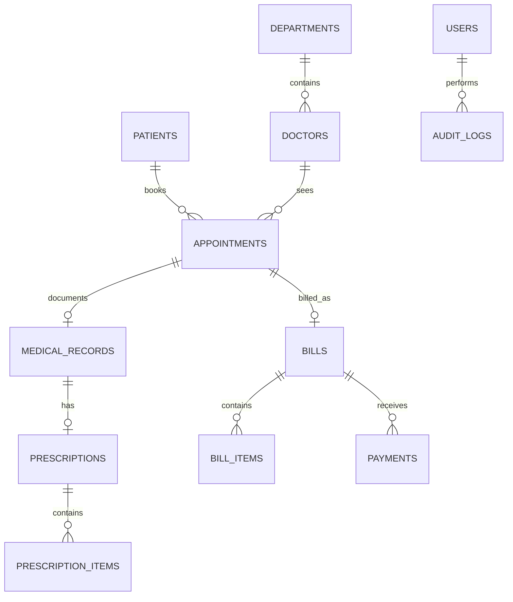

# 🏥 Hospital Management Portal

A desktop-based Hospital Management System developed using **Core Java, Java Swing, JDBC, MySQL, Maven, and BCrypt**. The application provides a centralized platform for managing hospital operations, patient records, billing, departments, and administrative activities.

## 🚀 Features

- **Authentication & Authorization**
    - Secure login and logout.
    - BCrypt password hashing.
    - Role-based access control.
    - Administrator-managed user accounts.

- **Patient Management**
    - Register new patients.
    - Search and view patient records.
    - Update patient information.
    - Deactivate patient records while preserving history.

- **Department & Doctor Management**
    - Department directory.
    - Doctor information and availability.
    - Consultation fee management.
    - Active status tracking.

- **Billing Management**
    - Generate and manage patient bills.
    - Maintain billing records.

- **Data Validation**
    - Input validation.
    - Service-layer business rules.
    - Database-backed persistence.

## 🛠️ Tech Stack

| Technology | Purpose |
|---|---|
| Java | Core application logic |
| Java Swing | Desktop user interface |
| JDBC | Database connectivity |
| MySQL | Relational database |
| Maven | Dependency management |
| BCrypt | Password hashing |
| JUnit | Unit testing |

## 🏗️ Project Architecture

The application follows a layered architecture:

- **UI Layer:** Handles user interaction through Java Swing.
- **Service Layer:** Implements business logic and validation.
- **Utility Layer:** Manages database connectivity and reusable utilities.
- **Database Layer:** Stores application data using MySQL.

## 📂 Project Structure

```text
hospital-management-portal/
│
├── src/
│   ├── main/
│   │   ├── java/
│   │   │   └── com/hospital/
│   │   │       ├── service/
│   │   │       ├── ui/
│   │   │       └── util/
│   │   │
│   │   └── resources/
│   │       └── db/
│   │           ├── schema.sql
│   │           └── seed.sql
│   │
│   └── test/
│       └── java/
│
├── pom.xml
├── .gitignore
└── README.md
```
### Relationship overview



## ⚙️ Installation & Setup

### Prerequisites

- Java JDK
- MySQL Server
- IntelliJ IDEA or another Java IDE
- Maven

### 1. Clone the repository

```bash
git clone https://github.com/kaiff67/hospital-management-portal.git
```

### 2. Open the project

Import the project into IntelliJ IDEA as a Maven project.

### 3. Configure MySQL

Create the database and execute the SQL scripts:

```sql
SOURCE path/to/schema.sql;
SOURCE path/to/seed.sql;
```

### 4. Configure database connectivity

Update the database connection settings in the application's database configuration utility.

Use your own local database credentials. Never commit passwords or sensitive credentials to GitHub.

### 5. Build the project

```bash
mvn clean install
```

### 6. Run the application

Run the application's main entry point from your IDE.

## 🧪 Testing

Run the unit tests using:

```bash
mvn test
```

## 🔐 Security Considerations

- Passwords are stored as BCrypt hashes.
- Role checks are implemented in service classes.
- Database credentials should be configured locally.
- Input validation is applied before processing operations.

## 📸 Screenshots

Screenshots of the application's login screen, dashboard, patient management, and billing modules will be added here.

## 👨‍💻 Developer

**Kaif Ahmad**

GitHub: [@kaiff67](https://github.com/kaiff67)

---

*This project is developed for educational and software development learning purposes. It is not certified for clinical or production deployment.*
